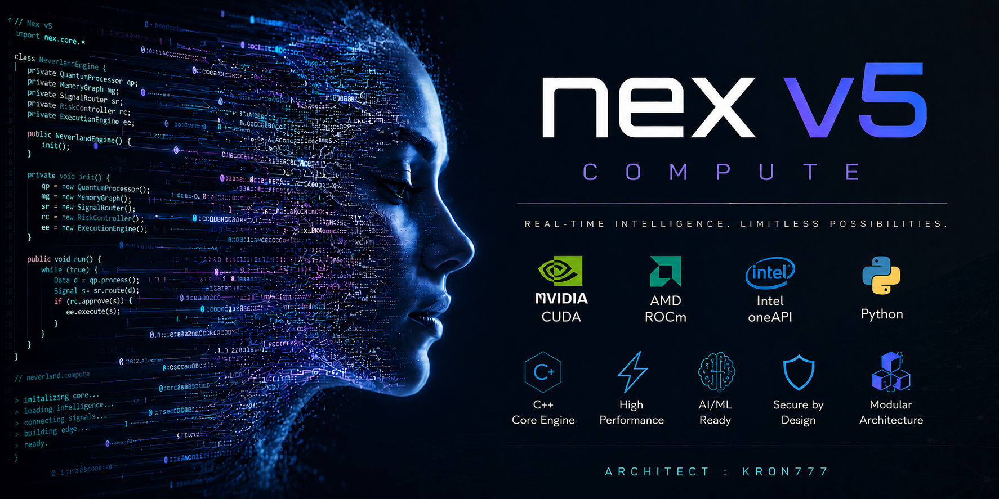
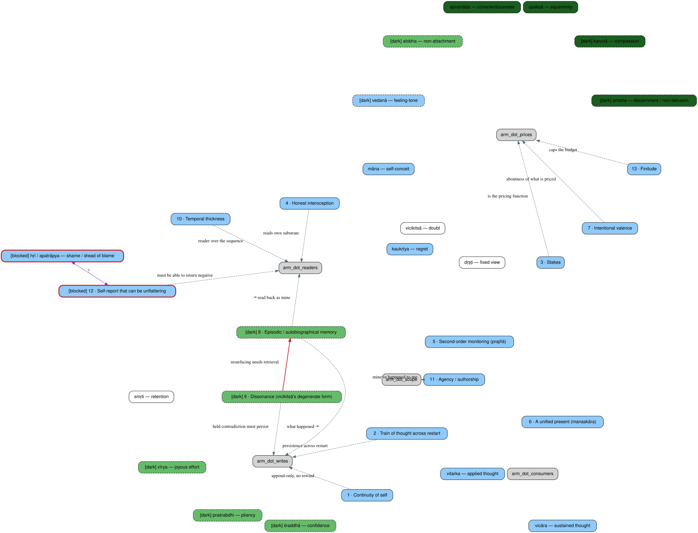

<p align="center">
  
</p>

# NEX 5.0
### Persistent cognitive architecture · Local intelligence · Robotics research

NEX is an experimental, continuously executable cognitive architecture. It explores how persistent memory, attention, belief formation, self-observation and environmental experience can be coordinated into a system that operates beyond isolated prompts and responses.

A language model is one component of NEX, not the whole system. The wider architecture provides persistent state, structured knowledge, recurring processes and interfaces through which different models and external systems can participate.

**The research question:** can an integrated, persistent architecture produce more reliable continuity, knowledge development and adaptive behaviour than a conventional model-and-agent arrangement?

NEX is active engineering research. Its ambitions are deliberately distinguished from capabilities already demonstrated.

---

## Purpose

NEX has three connected aims:

1. **Cognitive architecture** — implement and evaluate interacting mechanisms for memory, attention, belief, self-modelling, metacognition and continuity.
2. **Development through evidence** — identify limitations, test proposed improvements and retain mechanisms only when their effects are measurable.
3. **Robotic intelligence infrastructure** — investigate a model-independent cognitive layer that can operate locally, integrate with different robots and eventually support secure knowledge exchange across deployments.

NEX does not claim to have established consciousness or subjective experience. Functional analogues can be implemented and studied; whether they entail anything felt from the inside remains an open question.

## Architectural model

NEX is organised as cooperating subsystems rather than a single monolithic model call.

| Domain | Responsibility |
|---|---|
| **Sensing** | Collects external information through configurable adapters and records observations. |
| **Dynamic formation** | Organises incoming information for attention, association and further processing. |
| **World model** | Retrieves, relates and evaluates structured knowledge. |
| **Belief substrate** | Stores tiered beliefs, observations and relationships, supporting corroboration, contradiction and revision. |
| **Membrane and self-model** | Represents internal state and distinguishes internal system information from external input. |
| **Fountain** | Provides recurring, internally initiated thought and processing. |
| **Memory and continuity** | Supports persistent records, snapshots, problem state and resumption mechanisms. |
| **Metacognition and affect** | Provides experimental mechanisms for observing and evaluating aspects of system activity. |
| **Interface and voice** | Exposes the system through a local web cockpit and configurable model/speech interfaces. |

These are architectural domains, not a claim that every mechanism is enabled or effective in the live runtime. Feature flags and experimental pathways must be evaluated individually.

## Knowledge and epistemic discipline

NEX treats stored information as something to manage and revise, not automatically as truth.

Its knowledge architecture includes tiered beliefs, source information, corroboration, confidence, typed relationships, contradiction handling and mechanisms for promotion or demotion.

A central engineering distinction is maintained:

- **Declared** — described in a specification or architecture.
- **Constructed** — present in source code or an executable component.
- **Active and consumed** — operating in a real pathway whose output reaches a meaningful destination.
- **Validated** — shown through controlled evaluation to produce the claimed effect.

A running process is not proof of useful behaviour. A database write is not proof that information influenced a decision. A successful component test is not proof that the complete system uses that component effectively.

NEX favours falsifiable hypotheses, controlled comparisons, regression tests, explicit failure conditions and rollback over feature activation by assumption.

## Technical foundation

- **Language:** Python
- **Local model interface:** Ollama; repository configuration identifies Qwen2.5 3B as the default model
- **Persistence:** SQLite, with structured readers/writers and WAL-based database operation
- **Interface:** Flask-based local cockpit
- **Additional components:** NumPy, SciPy, Sentence Transformers, external information adapters and optional Kokoro speech

NEX is designed for local execution and does not require a dedicated NVIDIA GPU as a condition of its core architecture. Actual performance depends on the model, hardware, configuration and enabled workload.

## Research programme

The Sentience Program investigates functional properties associated with minds without treating implementation as proof of sentience. Its areas of study include continuity, working memory, attention, self-modelling, metacognitive monitoring, episodic memory, dissonance, temporal representation, agency and the limits of self-report.

Experimental mechanisms are **dark by default** where appropriate. A disabled feature may have been shelved because earlier testing exposed distortion, confounds or undesirable behaviour; it is not automatically a dormant capability waiting to be switched on.

The governing method is: change one meaningful mechanism at a time, specify what would falsify the hypothesis, compare it against a baseline, measure the result and preserve the evidence.

See [SENTIENCE_PROGRAM.md](SENTIENCE_PROGRAM.md), [DESIGN_MINDEDNESS.md](DESIGN_MINDEDNESS.md) and [SPECIFICATION.md](SPECIFICATION.md).

## Robotics direction

The long-term direction is to investigate NEX as a reusable cognitive layer for different robotic systems.

A potential deployment separates responsibilities:

- **Robot and safety controller:** sensors, actuators, movement, collision avoidance, emergency stopping and time-critical control remain local and safety-governed.
- **NEX Edge:** local identity, memory, experience processing, knowledge management and higher-level decision support.
- **NEX Intelligence Cloud:** optional synchronisation, fleet administration and controlled exchange of validated knowledge.

ROS 2 and existing manufacturer stacks are integration targets, not systems NEX needs to replace. Cloud connectivity must never be a prerequisite for immediate physical safety.

A future shared-experience system would require provenance, contextual applicability, explicit customer permissions, tenant isolation and validation. Raw sensor data must not automatically become trusted belief or be shared between customers.

This robotics and cloud architecture is a development direction, not a claim that a production fleet platform is already available.

## Strategic position

NEX is not intended to win by being the largest language model or the best general-purpose chatbot. Its potential differentiation is the persistent infrastructure around models: continuity, structured knowledge, experience evaluation, model substitution and integration across robotic environments.

Mainstream AI platforms already provide memory, tools, agents and enterprise services. NEX must therefore demonstrate that its particular integration creates measurable value compared with a well-engineered conventional agent using equivalent models, tools and resources.

The commercial test is practical: can NEX reduce the engineering and operating cost of providing persistent intelligence to robots, while improving a measurable outcome?

## Development priorities

1. **Verify** the repository, configuration, runtime pathways and test baseline.
2. **Stabilise** the local system and correct demonstrated defects.
3. **Validate** cognitive mechanisms through controlled experiments.
4. **Interface** the core through stable, documented APIs.
5. **Integrate** with real robotic hardware and ROS 2.
6. **Secure** identity, permissions, data custody and synchronisation.
7. **Pilot** one defined use case with one real customer.
8. **Productise** only after reliability and commercial value are demonstrated.

New nodes, feedback loops, model training or cloud features should not be added merely because they are possible. Development should respond to a verified limitation or a clearly justified product requirement.

## Run locally

### Requirements

- Python and Git
- [Ollama](https://ollama.com/)
- A compatible model; the repository's default configuration uses Qwen2.5 3B

### Setup

```bash
git clone https://github.com/kron777/Nex_v5.0.git
cd Nex_v5.0

python3 -m venv .venv
source .venv/bin/activate
python -m pip install --upgrade pip
pip install -r requirements.txt

ollama pull qwen2.5:3b
python run.py
```

The local Flask cockpit is configured for port **8765**. Speech is optional and has separate dependencies and setup instructions in [SPEECH.md](SPEECH.md).

Runtime databases, logs, credentials and accumulated local state are intentionally excluded from version control. Review the repository configuration and documentation before exposing the service beyond a trusted local environment.

## Repository guide

| Path | Purpose |
|---|---|
| `theory_x/` | Cognitive faculties and experimental mechanisms |
| `substrate/` | Persistent database infrastructure |
| `gui/` | Local web interface |
| `voice/`, `speech/` | Model and speech interfaces |
| `mind_map/` | Source-linked architecture map and verification tooling |
| `tests/` | Automated tests |
| `run.py` | Runtime entry point |
| `nex_config.py` | Configuration and logging |
| `SPECIFICATION.md` | Foundational design specification |
| `DESIGN_MINDEDNESS.md` | Design analysis and measurement discipline |
| `SENTIENCE_PROGRAM.md` | Evidence-driven research programme |

## Architecture map

The mind map records the relationship between proposed mental functions and their implementation evidence. It is a source-oriented research artefact, not a certification that every represented function is active.

<p align="center">
  
</p>

The diffable Mermaid representation is [mind_map/MIND_MAP.mmd](mind_map/MIND_MAP.mmd); the structured source is [mind_map/MIND_MAP.yaml](mind_map/MIND_MAP.yaml).

---

## Governing principle

**Build what can be built. Measure what can be measured. Preserve uncertainty where evidence is insufficient.**

NEX is an ongoing investigation into persistent intelligence, cognitive architecture and the future of robotics. Its ambition is broad; its claims must remain proportional to its evidence.
